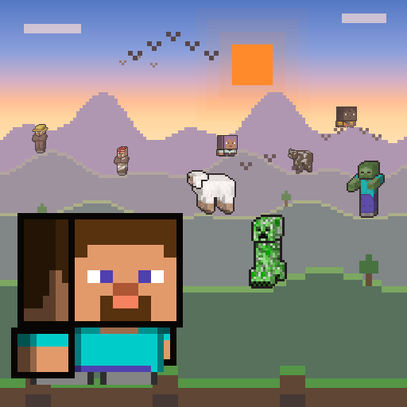

# Living Horizon

**Living Horizon** is a Minecraft mod that shows mobs and players far past your render
distance. It draws them on the game's terrain and on the terrain of **Voxy** and **Distant
Horizons**. It can also help performance: you can lower your simulation distance and still
see a living world.

> ⚠️ **This is a beta, so expect bugs.** I mainly play on 1.21.11 with Voxy, and it works
> there. I have not tested every loader and game version. Found a bug? Tell me on the
> [issues](https://github.com/MC-Skin-Creator/living-horizon/issues) page or on the
> [Discord](https://discord.gg/THSV9dexNj). Thanks to anyone who helps!

## Features

### Distant mobs

Shows mobs far past your render distance. These distant mobs are light copies of the real
ones, with no AI.

How distant mobs work

- They play ready-made animations that fit the ground around them: they walk, graze, hop and
  look around. Phantoms, ghasts and the ender dragon fly.
- A mob shows where your game or the server last saw it, and stays there from one session to
  the next. If it died or left since, it is forgotten when you come near.
- On a server with the mod, the server shares the mobs it knows, even those you never met.
  In single player, the mod reads the mobs around you the first time you open a world.
- **Guessed mobs** fill the land nobody has explored yet. The mod works out from the world's
  seed which mobs the game would put there, and where. They fill a world drawn far away by
  Distant Horizons, for example. They are a guess: they may be gone, or stand a little
  elsewhere, when you get there. This needs the mod on the server, and works in single
  player. Look through a spyglass to see them farther away, or press *Guess Nearby Mobs* to
  show them up to 1024 chunks around.
- They stand on the game's terrain, and on the terrain of far-terrain mods such as Voxy or
  Distant Horizons. Hills hide them.
- Far away, they become flat pictures instead of 3D models (*Simplified Mobs*). They cost much
  less to draw, so you can show many more.
- A mob in a boat or a minecart stays in it, and a rolling minecart keeps rolling. Pets told
  to sit stay seated.
- Boats stay where they were left, and so do vehicles from other mods, such as Immersive
  Aircraft's planes.
- *Mobs & Entities...* shows or hides each kind. Mobs with a name tag can always be shown.
  *Hide Underground Mobs* leaves out the mobs in caves and mines.
- They are only visual. Farms, spawning and the mob cap do not change, and you cannot hit a
  distant mob.

### Distant players

Shows other players at any distance, with their skin, gear and mount. This needs the mod on
the server: it shares their positions with the players who have the mod.

How distant players work

- Your game draws each player where the server says they are. A player gliding with an
  elytra is shown gliding.
- Far away, they become flat pictures instead of 3D models (*Simplified Players*).
- The server's owner chooses what is shared: how far, with teammates only, and which players
  and dimensions stay hidden. Players in spectator mode or invisible are never shared.
- *Player Render Distance* limits how far you see them.

### Offline players

When a player logs off, a copy with their name stays where they left, until they come back.
It is only visual: the world does not know it exists.

How offline players work

- Up close, they have a small AI. They stroll, sit, look in chests and use workstations. They
  sleep in a bed at night, gather by a campfire in the evening and take shelter from the
  rain. Two of them nearby may chat, and one near water may fish.
- Far away, they play ready-made animations.
- They look back at you when you look at them up close, crouch when you crouch, and raise a
  shield against monsters.
- You can push them out of your way. They cannot push you, and mobs ignore them.
- They keep their mount: a horse, a boat, a happy ghast. One who left swimming waits on the
  shore, or rows a boat.
- Their name shows with *(offline)*. Look at one up close to see when they were last seen.
- On a server with the mod, you see those who left before you joined. In single player, the
  world's players show from the start, even those from before the mod was installed.
  Without the mod on the server, you only see those you saw leave.
- They keep the look another mod gave them, such as their Minecraft Comes Alive model.
- *Max Offline* limits how many show at once, and *Roaming Radius* how far they wander.

### Birds

Adds birds to the Overworld's sky, visible from far away. They exist in your game only: two
players do not see the same birds.

How birds work

- Up close, they have a small AI. They perch on trees, buildings, fields and beaches, ducks
  swim, and pigeons and bats fly off when you come close.
- Far away, they play ready-made flights.
- Flocks, geese flying in a V, birds of prey, seagulls over the coast, pigeons on tall
  buildings, robins, tits, ducks, parrots and bats at night. *Bird Types...* picks them.
- They are small 3D models that flap their wings. *Bird Style* turns them into flat 2D birds.
- *Bird Density*, *Bird Distance*, *Bird Size* and *Min. Flight Height* set how many you see,
  how far, how big and how high.

### Settings

Open them from the Options screen or `/livinghorizon config`.

What the settings offer

- A *Preset* (*Low*, *Normal*, *High*, *Ultra*) sets everything at once.
- When you change a distance, its limit shows in the world behind the menu.
- Right-click a slider that ends in *Unlimited* to type a value. The arrow keys move any
  slider one step.
- Keys of your choice switch distant players on and off, switch *Hide Underground Mobs* and
  open the settings.
- The mod and its in-game changelog are in 14 languages.
- The settings are also in other mods' menus, such as Sodium's *Video Settings*.
- Distant mobs are lit by shader packs, such as Photon.

## Performance

The mod uses two techniques to stay light.

### No AI far away

Far entities have no AI. They play ready-made animations that fit the ground around them.

- **Mobs**: no AI. They walk, graze and look around.
- **Offline players**: a small AI when you are close, so they use beds and chests.
  Ready-made animations when you are far.
- **Birds**: a small AI when you are close, ready-made flights when you are far.

Offline players are only visual. The world does not know they exist: you walk
through them, they cannot block or push you, and mobs ignore them.

### Simplified Entities

Many games draw far objects as **impostors**: a flat picture instead of a 3D model. Living
Horizon does the same for far mobs, vehicles and players, each with its own switch:
*Simplified Mobs*, *Simplified Entities* and *Simplified Players*. It costs much less to draw,
so you can show many more entities.

Keep *Simplified Mobs* on if you raise *Mob Render Distance* or *Max Mobs*. A *Preset*
(*Low*, *Normal*, *High*, *Ultra*) sets everything at once.

**Careful:** *Max Mobs* and *Mob Render Distance* both on *Unlimited* can crash the game.

### Everything runs on your computer

Your game handles the far animations, the offline players and the birds. The server
only shares positions. So two players can see the same far mob doing different things.

## Multiplayer

Everything works in single player. On a server, some features need the mod on the server:

| Feature | Single player | World opened to LAN | Server with the mod | Server without the mod |
|---|---|---|---|---|
| Distant mobs | ✓ | ✓ | ✓ | Only the mobs you met |
| Distant players | — | ✓ | ✓ | ✗ |
| Offline players | ✓ | ✓ | ✓, even those who left before you joined | Only those you saw leave |
| Birds | ✓ | ✓ | ✓ | ✓ |

- **Server**: put the same jar in the server's `mods/` folder (with the Fabric API on Fabric
  and Quilt). Nothing else to set up.
- **LAN**: nothing to do.
- Players without the mod can still join.
- The server shares every player's position with the players who have the mod. Tell your
  players.
- Players in spectator mode or invisible are never shared.

### Server settings

The server writes `config/livinghorizon-server.json` the first time it starts. Edit it to
choose what it shares. Changes apply after a few seconds, without a restart.

| Setting | Default | What it does |
|---|---|---|
| `sharePlayers` | `true` | Shares players online past the view distance |
| `playerRange` | `0` | How far a player is shared, in blocks. `0` is any distance |
| `teamsOnly` | `false` | Shares players with their own team only (`/team`) |
| `hideSpectators` | `true` | Never shares players in spectator mode |
| `hideInvisible` | `true` | Never shares invisible players |
| `hiddenPlayers` | `[]` | Names never shared, such as `["Steve"]` |
| `hiddenDimensions` | `[]` | Dimensions where nothing is shared, such as `["minecraft:the_nether"]` |
| `shareOfflinePlayers` | `true` | Shares offline players where they left |
| `shareMobs` | `true` | Shares the remembered mobs past the view distance |
| `seedMobs` | `true` | Shares the mobs of land nobody has explored yet, guessed from the seed |
| `seedMobRange` | `512` | How far from a player those mobs are shared, in blocks, up to `2048` |
| `shareSeed` | `false` | Sends the world's seed to the players with the mod, so their game guesses those mobs anywhere. Whoever has the seed knows the whole world |

These settings only change what the server sends. Within the view distance, players see
each other as usual. What a player's game saw on its own stays in its memory.

## Getting started

1. Install the file for your game version and loader (see *Requirements*). Voxy, Distant
   Horizons, Lodistance, Ecstatic and Far View are optional.
2. Keep the default settings. *Restore Defaults* puts them back.

Open the settings from the Options screen, Mod Menu, Sodium's *Video Settings* (Sodium 0.8
and later) or `/livinghorizon config`.

## Useful commands

| Command | What it does |
|---|---|
| `/livinghorizon config` | Opens the settings |
| `/livinghorizon scan` | Scans the mobs around you again if needed. Single player only, and done on its own the first time you open a world. |

## Requirements

- Minecraft 1.20 to 1.21.11 and 26.1 to 26.3.
- Fabric or Quilt (with [Fabric API](https://modrinth.com/mod/fabric-api)), NeoForge or Forge.
- [Voxy](https://modrinth.com/mod/voxy), [Distant Horizons](https://modrinth.com/mod/distanthorizons), [Lodistance](https://www.curseforge.com/minecraft/mc-mods/lodistance), [Ecstatic](https://modrinth.com/mod/ecstatic) or [Far View](https://www.curseforge.com/minecraft/mc-mods/far-view): optional.
- [Mod Menu](https://modrinth.com/mod/modmenu): optional, on Fabric and Quilt.

Download from the [releases](https://github.com/MC-Skin-Creator/living-horizon/releases)
page, one file per game version and loader:

| Minecraft | Fabric, Quilt | NeoForge | Forge |
|---|---|---|---|
| 1.20, 1.20.1 | ✓ | | 1.20.1 |
| 1.20.2 | ✓ | | ✓ |
| 1.20.3, 1.20.4 | ✓ | | 1.20.4 |
| 1.20.5, 1.20.6 | ✓ | 1.20.6 | 1.20.6 |
| 1.21, 1.21.1 | ✓ | 1.21.1 | 1.21.1 |
| 1.21.2, 1.21.3 | ✓ | 1.21.3 | 1.21.3 |
| 1.21.4, 1.21.5 | ✓ | ✓ | ✓ |
| 1.21.6 to 1.21.8 | ✓ | 1.21.8 | 1.21.8 |
| 1.21.9, 1.21.10 | ✓ | 1.21.10 | 1.21.10 |
| 1.21.11 | ✓ | ✓ | ✓ |
| 26.1 to 26.1.2 | ✓ | ✓ | 26.1.2 |
| 26.2, 26.3 | ✓ | ✓ | ✓ |

## Compatibility

| Mod | Notes |
|---|---|
| [Voxy](https://modrinth.com/mod/voxy) | Mobs and players are visible on its terrain. |
| [Distant Horizons](https://modrinth.com/mod/distanthorizons) | From 2.3 on. Mobs and players are visible on its terrain. |
| [Lodistance](https://www.curseforge.com/minecraft/mc-mods/lodistance) | Fabric, 26.3. Mobs and players are visible on its terrain, with OpenGL and without shaders. |
| [Ecstatic](https://modrinth.com/mod/ecstatic) | NeoForge, 1.21.1, single player. Mobs are visible on its terrain, without shaders. |
| [Far View](https://www.curseforge.com/minecraft/mc-mods/far-view) | Forge and NeoForge, 1.20.1 to 1.21.4. Mobs are visible on its terrain. |
| [Bobby](https://modrinth.com/mod/bobby) | Mobs and players are visible on the terrain it keeps past the server's view distance. |
| [Iris](https://modrinth.com/mod/iris) | Shader packs work, such as the two below. |
| [Photon](https://modrinth.com/shader/photon-shader) | Shader pack. Checked: it works. |
| [Complementary Unbound](https://modrinth.com/shader/complementary-unbound) | Shader pack. Checked: it works. |
| [Sodium](https://modrinth.com/mod/sodium) | From 0.8, the settings are also in Sodium's *Video Settings*. |
| GeckoLib | Works. From 1.21.2 to 1.21.8 its mobs are not drawn far away yet ([#67](https://github.com/MC-Skin-Creator/living-horizon/issues/67)). |
| [Immersive Aircraft](https://modrinth.com/mod/immersive-aircraft) | Its aircraft stay visible far away, where you left them. |
| [Ambient Birds](https://modrinth.com/mod/ambient-birds) | Its birds keep flying far away. |

Mobs from other mods should work. Mods not tested yet are listed under the
[`mod compatibility`](https://github.com/MC-Skin-Creator/living-horizon/labels/mod%20compatibility)
label.

## FAQ

### How it works

Is it only visual? Does it break mob farms?

It is only visual, no AI. The real mobs work as without the mod, so farms, spawning and the
mob cap do not change. You cannot hit a distant mob.

Are the distant mobs real, or placed at random?

They are real mobs, where your game or the server last saw them. One that died or despawned
since can still show until you come near it. Then it is forgotten.

How is it different from a higher simulation or entity distance?

A higher simulation distance makes the server run more real mobs, which costs a lot, and the
server still only sends them so far. Living Horizon draws copies that the server does not
run. They play ready-made animations, and far away they become flat pictures (*Simplified
Entities*).

How far does it show mobs and players?

Mobs: 512 blocks by default, up to *Unlimited* with *Mob Render Distance*. Players, boats and
vehicles: any distance by default, which *Player Render Distance* and *Entity Render Distance*
can limit. A mob only shows once your game or the server has seen it.

### Compatibility

Does it work with my mod?

Most likely. Voxy, Distant Horizons, Lodistance, Ecstatic, Far View, Bobby, Sodium, Iris and shader packs work with it (see
*Compatibility*). Living Horizon only adds its own figures: it does not change how other
mods draw the world. Mods not tested yet are listed under the
[`mod compatibility`](https://github.com/MC-Skin-Creator/living-horizon/labels/mod%20compatibility)
label. If something breaks, open an
[issue](https://github.com/MC-Skin-Creator/living-horizon/issues) with the mod's name and
version.

Do mobs from other mods show far away?

Yes, as long as they use Minecraft's own entity system. If a mod's entities work too
differently, ask me to add support for it, in an
[issue](https://github.com/MC-Skin-Creator/living-horizon/issues) or on the
[Discord](https://discord.gg/THSV9dexNj) :)

Do I need Voxy, Distant Horizons, Lodistance, Ecstatic or Far View?

No. Without them, distant mobs and players show on the game's own terrain, out to your
render distance. With one of them, they also show on its far terrain.

### Performance and settings

Will it lower my frame rate?

Drawing more entities costs frame rate. If your game slows down, keep *Simplified Mobs* and
*Simplified Entities* on and pick a lower *Preset*. *Max Mobs* and *Mob Render Distance* both on *Unlimited* can
crash the game.

Can I choose what is shown?

Yes. *Show Mobs*, *Show Players*, *Offline Players* and *Show Birds* turn each part on or
off. *Mobs & Entities...* chooses mob by mob.

Does it change my world or load chunks?

No. It changes nothing in your world and loads no chunk. It keeps what it remembers in files
of its own: in the `config` folder, and in `livinghorizon-positions.dat` in the world folder
for what the server shares. Removing the mod leaves your world as it was.

On a server, the mod only sends positions to the players who have it.

### Multiplayer

Does the server need the mod?

No. Almost everything works in single player, and you can join any server with it. But
players at any distance need the mod on the server, and the server then shares more mobs and
offline players. See *Multiplayer*.

Does it work on Paper or Spigot servers?

You can play on them with the mod, as on any server without it. The server side runs on
Fabric, Quilt, NeoForge and Forge only, so a Paper or Spigot server shares nothing. A
plugin for Paper is discussed in
[#156](https://github.com/MC-Skin-Creator/living-horizon/issues/156).

I see no distant mobs or players. Why?

- Distant players need the mod on the server. Its owner may also limit who is shared (see
  *Server settings*).
- On a server without the mod, only the mobs you met show.

Can it be used to cheat? Is it allowed on servers?

It only shows other players where the server allows it. Distant players only show on a
server that has the mod, and its owner chooses what it shares: how far, with teammates
only, and which players and dimensions stay hidden. `"sharePlayers": false` turns it off
(see *Server settings*). Invisible players and players in spectator mode are never shared.
Sneaking players are, for now
([#269](https://github.com/MC-Skin-Creator/living-horizon/issues/269)).

On other servers, you only see what your own game saw. The mod sends nothing to the server.
Each server has its own rules about mods, though: ask its staff.

### Downloads and license

Is there a Bedrock version?

No. Living Horizon is a mod for Minecraft Java Edition.

My game version is not supported. Will it be?

Tell me on the [Discord](https://discord.gg/THSV9dexNj) which version and loader you play.
It helps me choose what comes next.

Can I put it in a modpack?

Yes. Use the official file and credit it.

What if the project is abandoned?

The license plans for it. Once the project is declared abandoned (this repository archived,
or the README saying so), its license turns into the GPL: anyone may carry the project on,
with credit. See section 5 of the [LICENSE](LICENSE).

### AI

Was it made with AI?

Yes. I am a full-stack developer, specialised in video games, and it is my job. I have made
mods since 2017: Call of Duty: Black Ops III maps such as
[Nuketown Zombies Legacy](https://steamcommunity.com/sharedfiles/filedetails/?id=2180904327),
with over a million downloads on the Steam Workshop (see my
[portfolio](https://clixmods.github.io/)). The ideas and the techniques come from game
development: impostors, LODs and ready-made animations are tricks games have used for years.
AI writes much of the code. I decide how the mod works, test it in the game and fix what
goes wrong. Without AI, a project this size would have taken me too long to make at all.

Is it on Modrinth? Why is it unlisted there?

It is on Modrinth, but unlisted: it does not show in Modrinth's search. Since August 2026,
[Modrinth's rules](https://modrinth.com/legal/rules) do not allow a project made mainly
with AI to be public, so its staff unlisted it. CurseForge, Nexus Mods and the
[releases](https://github.com/MC-Skin-Creator/living-horizon/releases) page have the same
files.

Unlisted does not mean unsafe. It is about how the mod is made, not about what it does:

- The code is public: anyone can read it in this repository.
- GitHub builds every release from this code, and its build logs are public.
- The mod has no code of its own that connects to the internet. Player skins come from
  Mojang through the game, and the Discord link opens only when you click it.

## Made with AI

AI is part of this project's workflow: Living Horizon is made with [Claude](https://claude.ai).

You can use AI to contribute too, no problem. Just keep thinking about what it writes.
Claude works best here: it reads `CLAUDE.md` and the skills in `.claude/skills/`, which
describe how the project works.

## More

- Something wrong? Open an [issue](https://github.com/MC-Skin-Creator/living-horizon/issues)
  with your game version, loader and a screenshot.
- Questions, news and help: join the [Discord](https://discord.gg/THSV9dexNj).
- [docs/technical.md](docs/technical.md): every setting, the debug tools and how the mod
  works in the code.
- Build: `./gradlew :1.21.11:build` for one target, `./gradlew buildAndCollect` for every jar.
- License: source-available under the [Living Horizon License](LICENSE), copyright 2026
  clixmods. The unchanged jar may be redistributed with credit; forks are not allowed.
- Credits: made by clixmods. Contributors: JonesJugHead. Testers: ISessen, largitalian. Full list in [CREDITS.md](CREDITS.md).
- Contributing: pull requests to this repository only, see [CONTRIBUTING.md](CONTRIBUTING.md).

Minecraft is a trademark of Mojang Studios. This project is not affiliated with or
endorsed by Mojang Studios or Microsoft.
