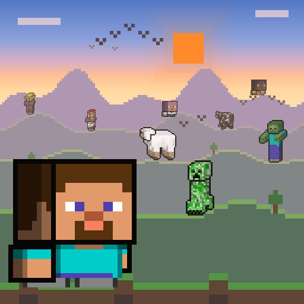

<p align="center"></p>

# Living Horizon

Gives life to the distance. Players and mobs stay visible far past your render distance,
and birds bring the sky to life. It works with the game alone, at any render distance, and
on top of far-terrain mods such as Voxy and Distant Horizons.

A client-side mod for Fabric, Quilt, NeoForge and Forge, on Minecraft **1.20 to 1.21.11**
and **26.1 to 26.3**. It follows the game's language: English, French, German, Spanish,
Italian, Brazilian Portuguese, Polish, Turkish, Russian, Ukrainian, Simplified and
Traditional Chinese, Japanese and Korean.

## Features

- **Other players far away.** They keep walking where they are, past the range where the
  server stops sending them, with their skin, cape, elytra, armour and what they ride.
- **A living distance.** Animals, villagers and golems graze and wander around far-off
  villages, hidden by the terrain in front of them, shaders included.
- **Birds in the sky.** Flocks, geese in a V, gulls on the coast, bats at night.
- **Players who logged off.** They live their life where they left - a stroll, a seat, a bed
  at night - until they come back, on their horse, boat or happy ghast if they had one.
- **Simplified Entities.** Far players and mobs can be drawn as flat pictures of themselves,
  so that crowds of them cost little.
- **Fully configurable.** Which mobs, which birds, how many and how far.

## Installation

Download the jar for your game version and loader from the
[releases](https://github.com/MC-Skin-Creator/living-horizon/releases) page and drop it into
`.minecraft/mods/`. Jars are named `livinghorizon-<version>+mc<game version>-<loader>.jar`
(no loader suffix for Fabric).

- **Fabric**: [Fabric Loader](https://fabricmc.net/use/) 0.15.11 or newer and the
  [Fabric API](https://modrinth.com/mod/fabric-api).
  [Mod Menu](https://modrinth.com/mod/modmenu) is optional and adds a settings button.
- **Quilt**: Quilt Loader with the Fabric API (QFAPI).
- **NeoForge** (1.20.6 and later) and **Forge**: nothing else.

[Voxy](https://modrinth.com/mod/voxy) and
[Distant Horizons](https://modrinth.com/mod/distanthorizons) are optional: the mod finds them
by itself.

### Multiplayer

Distant mobs work everywhere on their own. To see **other players** far away, the server
must share their positions, and only a server with the mod does:

- **Dedicated server**: put the same jar in the server's `mods/` folder (with the Fabric API
  on Fabric and Quilt). Nothing else to set up.
- **LAN or single player**: nothing to do, the host's game is the server.

Players without the mod can still join and see the game as usual. Every player's position
is shared with the players who have the mod: let your players know.

## Supported versions

| Minecraft | Java | Fabric, Quilt | NeoForge | Forge |
|---|---|---|---|---|
| 1.20, 1.20.1 | 17 | ✓ | | 1.20.1 |
| 1.20.2 | 17 | ✓ | | ✓ |
| 1.20.3, 1.20.4 | 17 | ✓ | | 1.20.4 |
| 1.20.5, 1.20.6 | 21 | ✓ | 1.20.6 | 1.20.6 |
| 1.21, 1.21.1 | 21 | ✓ | 1.21.1 | 1.21.1 |
| 1.21.2, 1.21.3 | 21 | ✓ | 1.21.3 | 1.21.3 |
| 1.21.4 | 21 | ✓ | ✓ | ✓ |
| 1.21.5 | 21 | ✓ | ✓ | ✓ |
| 1.21.6 to 1.21.8 | 21 | ✓ | 1.21.8 | 1.21.8 |
| 1.21.9, 1.21.10 | 21 | ✓ | 1.21.10 | 1.21.10 |
| 1.21.11 | 21 | ✓ | ✓ | ✓ |
| 26.1 to 26.1.2 | 25 | ✓ | ✓ | 26.1.2 |
| 26.2 | 25 | ✓ | ✓ | ✓ |
| 26.3 | 25 | ✓ | ✓ | ✓ |

Versions below `1.0.0` are marked *beta*.

## Compatibility

| Mod | Notes |
|---|---|
| [Voxy](https://modrinth.com/mod/voxy) | Mobs and players are visible on its terrain. |
| [Distant Horizons](https://modrinth.com/mod/distanthorizons) | From 2.3 on. Mobs and players are visible on its terrain. |
| Iris and shader packs | Photon and Complementary checked. |
| [Sodium](https://modrinth.com/mod/sodium) | From 0.8, the settings are also in Sodium's *Video Settings*. |
| [Mod Menu](https://modrinth.com/mod/modmenu) | Adds the settings button on Fabric. |
| Distant Friends | Its mannequins are shown far away (from 1.21.9). |
| GeckoLib | Works. From 1.21.2 to 1.21.8 its mobs are not drawn far away yet ([#67](https://github.com/MC-Skin-Creator/living-horizon/issues/67)). |

Mobs from other mods are drawn through the game's own renderer, so most should just work.
Popular mods still to check are tracked under the
[`mod compatibility`](https://github.com/MC-Skin-Creator/living-horizon/labels/mod%20compatibility)
label.

On versions before 1.21.9, the debug outlines and F3 lines are not available.

## Getting started

- **Settings**: the *Living Horizon...* button on the Options screen, Mod Menu's
  *Configure*, the mod list's *Config* button, or `/livinghorizon config`. The defaults are
  the best balance; *Restore Defaults* puts everything back.
- **Fill the horizon**: a mob is remembered once you have met it. In single player,
  *Scan Nearby Mobs* (or `/livinghorizon scan`) shows the mobs around you at once.
- **Commands**: `/livinghorizon` lists the players followed and says whether the server
  shares positions.
- A key (unbound by default, under *Living Horizon* in Controls) toggles the distant figures.

> **Careful with the limits.** *Max Mobs* and *Mob Render Distance* both set to
> *Unlimited*, with every kind of mob ticked, can freeze the game on a large world.

Every setting, the debug tools and how the mod works are described in
[docs/how-it-works.md](docs/how-it-works.md).

## Building

```sh
./gradlew :1.21.11:build          # one node: compiles and runs the tests
./gradlew :1.20.1-forge:build     # nodes are <game version>[-quilt|-neoforge|-forge]
./gradlew buildAndCollect         # every jar in build/libs/<version>/
```

## License

Source-available under the [Living Horizon License](LICENSE), copyright 2026 clixmods.

- You can read the code, build it, and run the mod alone or in a modpack.
- The official jar can be redistributed unchanged, crediting Living Horizon and clixmods
  with a link to this repository.
- Forks, modified versions and reuse of the code are not allowed while the project is
  maintained. If it is abandoned (this repository archived), it passes to the GPL-3.0.

Versions published before this license were under the GPL-3.0 and keep it.

## Contributing

Pull requests are welcome, to this repository only: see [CONTRIBUTING.md](CONTRIBUTING.md).

Minecraft is a trademark of Mojang Studios. This project is not affiliated with or
endorsed by Mojang Studios or Microsoft.
